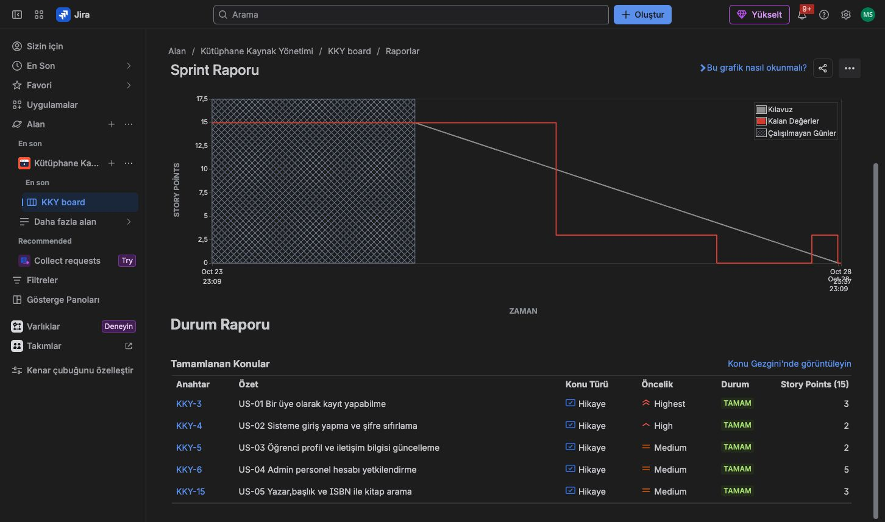
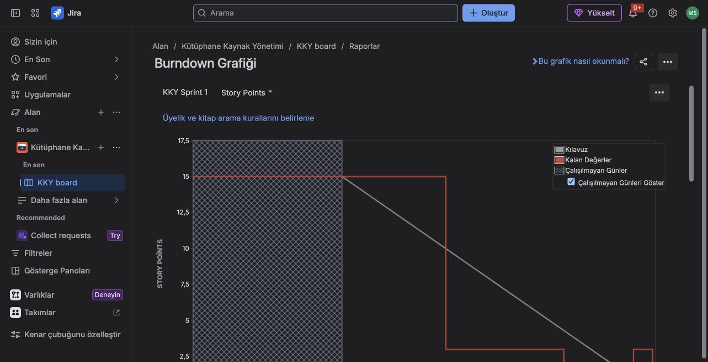
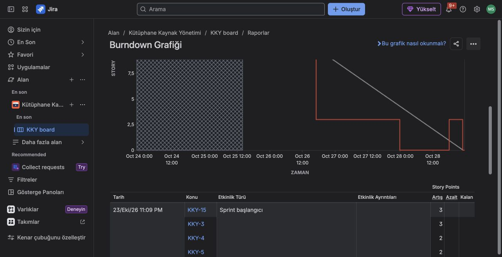
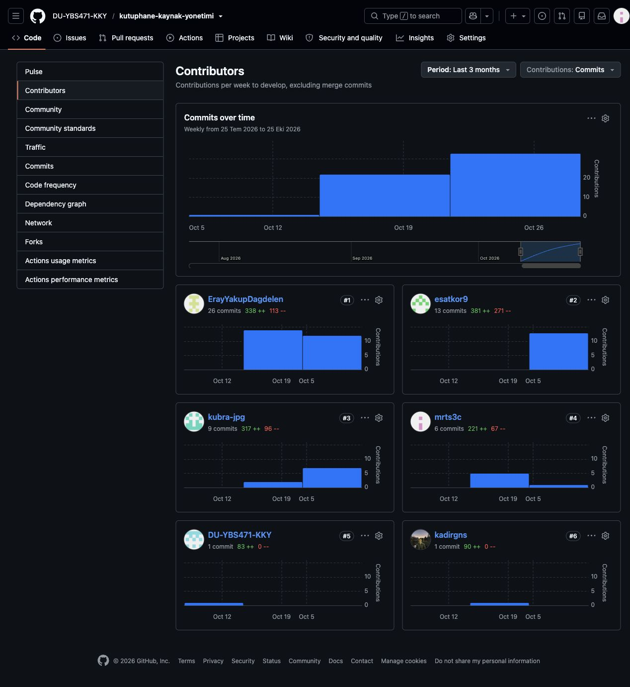

# Sprint 1 Review Raporu

**Hazırlayan:** Mert Seçkin  
**Son kontrol:** 29 Ekim 2026  
**Planlanan aralık:** 21–28 Ekim 2026  
**Gerçek başlangıç:** 23 Ekim 2026, 23.09  
**Gerçek bitiş:** 28 Ekim 2026, 23.37  
**PO:** Eray Yakup Dağdelen | **SM:** Esat Kor

## 1. Sprint sonucu

Sprint 1'in kapanışını Jira Sprint Raporu ve Burndown geçmişinden doğruladım. Esat sprinti 28 Ekim saat 23.37'de kapatmış. Beş işin tamamı Done; planlanan 15 SP'nin 15'i tamamlanmış (%100), sonraki sprinte devreden iş yok. Kayıt, giriş, profil, yetkilendirme ve kitap arama için gereksinim, ekran taslağı ve kontrol senaryoları ortak depoda bulunuyor.

| İş | Sorumlu | SP | Son durum | Çıktı ve inceleme |
|---|---|---:|---|---|
| [US-01 / KKY-3](https://dagdelen41.atlassian.net/browse/KKY-3) Öğrenci kaydı | Eray | 3 | Done | [PR #7](https://github.com/DU-YBS471-KKY/kutuphane-kaynak-yonetimi/pull/7), [#12](https://github.com/DU-YBS471-KKY/kutuphane-kaynak-yonetimi/pull/12), [#13](https://github.com/DU-YBS471-KKY/kutuphane-kaynak-yonetimi/pull/13): kayıt, aktivasyon ve şifre kontrolleri. |
| [US-02 / KKY-4](https://dagdelen41.atlassian.net/browse/KKY-4) Giriş ve şifre sıfırlama | Eray | 2 | Done | [PR #19](https://github.com/DU-YBS471-KKY/kutuphane-kaynak-yonetimi/pull/19): kriterler testteki sırayla eşleştirildi; sıfırlama kriter 3, kilit kriter 4. |
| [US-03 / KKY-5](https://dagdelen41.atlassian.net/browse/KKY-5) Profil güncelleme | Eray | 2 | Done | [PR #16](https://github.com/DU-YBS471-KKY/kutuphane-kaynak-yonetimi/pull/16): bildirim tercihi ekran seçeneği ortak depoya alındı. |
| [US-04 / KKY-6](https://dagdelen41.atlassian.net/browse/KKY-6) Personel yetkilendirme | Eray | 5 | Done | [PR #7](https://github.com/DU-YBS471-KKY/kutuphane-kaynak-yonetimi/pull/7) ve [#13](https://github.com/DU-YBS471-KKY/kutuphane-kaynak-yonetimi/pull/13): yetki verme, geri alma ve yetkisiz erişim belgeleri. |
| [US-05 / KKY-15](https://dagdelen41.atlassian.net/browse/KKY-15) Kitap arama | Esat | 3 | Done | [PR #15](https://github.com/DU-YBS471-KKY/kutuphane-kaynak-yonetimi/pull/15) ve [#23](https://github.com/DU-YBS471-KKY/kutuphane-kaynak-yonetimi/pull/23): kategori filtresi, sonuç alanları ve sonuç bulunamama senaryosu. |

## 2. İnceleme ve geri bildirimler

Kontrolümü gereksinimler, metin tabanlı ekran taslakları, senaryo tabloları ve işlem geçmişi üzerinden yaptım. Çalışan bir uygulamada test yürütmedim; senaryolardaki “Geçti” kayıtları dosya sahiplerinin belge kontrolü sonuçlarıdır. Kayıt aktivasyonu, üç hatalı girişte kilit, profil bildirimi ve kitap arama çıktılarının eklenmesini doğruladım.

Abdülkadir'in PR #8'deki önceki incelemesinde istediği gerçek başlangıç ve US-05 Epic güncellemeleri rapora işlendi. [Review PR #17](https://github.com/DU-YBS471-KKY/kutuphane-kaynak-yonetimi/pull/17) Eray'ın 28 Ekim onayıyla birleşti. Son kitap arama teslimi PR #23 de Eray'ın onayıyla birleşti. [Retro PR #22](https://github.com/DU-YBS471-KKY/kutuphane-kaynak-yonetimi/pull/22), Kübra ve Enes'in yazılı görüşlerini ve Sprint 2 takip planlarını içeriyor. Ayrı bir toplantı katılım kaydı eklemedim.

## 3. Kapanış kontrolü ve takip

Burndown'da US-05'in yeniden açılıp 28 Ekim saat 22.58'de tekrar tamamlandığı görülüyor. Kapanışta kalan puan sıfır. Grafiği bu işlem geçmişiyle birlikte kaydettim.

US-02 kriter atfı düzeltildi. US-05'in son senaryosu ortak depoya girdi; ancak test tablosundaki kriter etiketleri için küçük bir belge düzeltmesi gerekiyor: yazar/ISBN araması kriter 1, sonuç alanları kriter 3, sonuç bulunamaması kriter 4 ile eşleştirilmeli. Esat'ın bu atıfları düzeltmesini takip edeceğim; bu madde Jira'daki kapanış sonucunu değiştirmiyor.

Sprint 2'de kendi US-08–10 ekran, işlem akışı ve belge kontrolü çalışmalarımı hazırlayıp bağımsız incelemeye sunacağım.

## 4. Kapanış kanıtları

Görselleri 29 Ekim 2026'da kaydettim. Contributors görüntüsü develop dalının son üç aylık, merge commit'lerini hariç tutan görünümüdür; yalnızca Sprint 1'in kişi başı commit sayımı olarak değerlendirmedim.

### Ek 1 Sprint Raporu

[Canlı Sprint Raporu](https://dagdelen41.atlassian.net/jira/software/c/projects/KKY/boards/2/reports/sprint-retrospective)

### Ek 2 Burndown

Grafiğin üst bölümü ve sıfıra inen sonuç bölümü aynı görünümden kaydedildi.

[Canlı Burndown](https://dagdelen41.atlassian.net/jira/software/c/projects/KKY/boards/2/reports/burndown-chart)

### Ek 3 GitHub katkıları

[Canlı Contributors](https://github.com/DU-YBS471-KKY/kutuphane-kaynak-yonetimi/graphs/contributors) · [Ortak rapor](https://docs.google.com/document/d/1IX7KqhIBBCtKO-QIxZ8Pj1QFw0yYov0M2tPioCW0bQs/edit)
