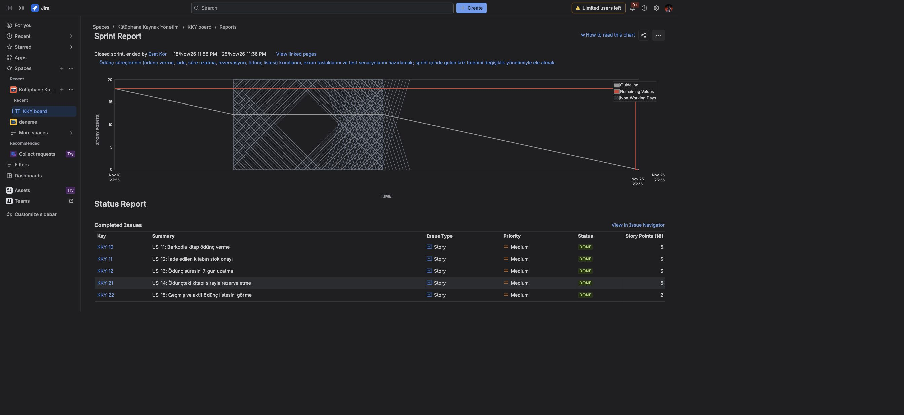
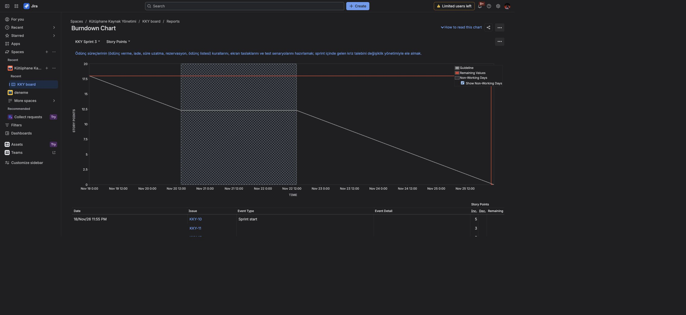
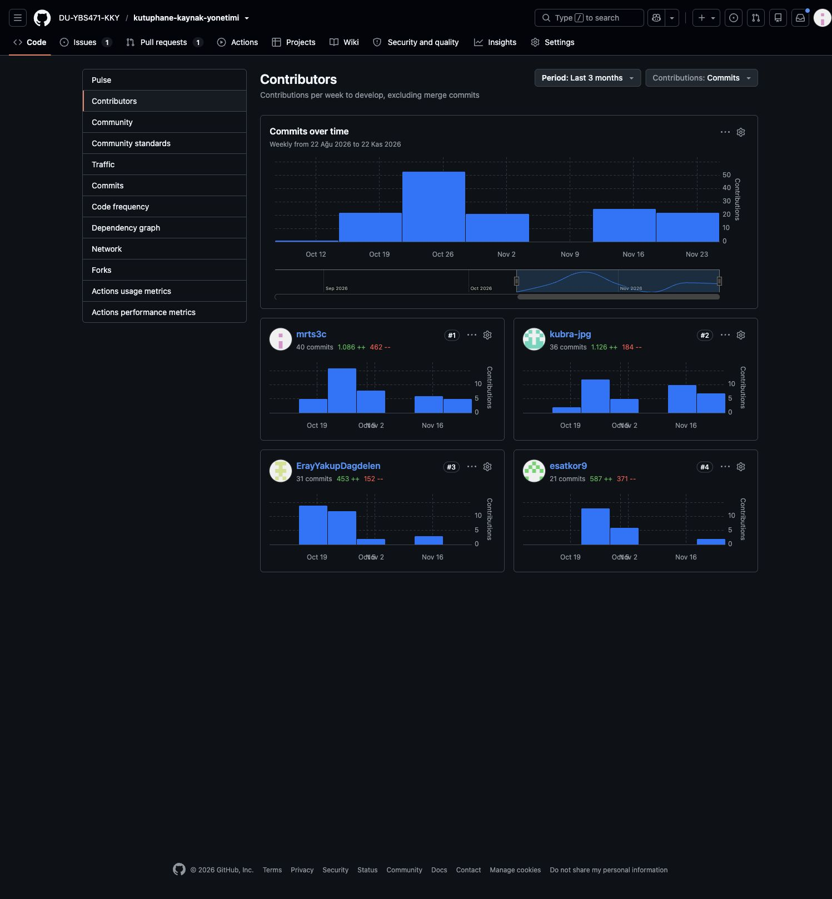

# Sprint 3 Review kapanış kaydım

Mert Seçkin — 25 Kasım kapanışı; ekler 26 Kasım 2026’da tamamlandı.

| Sprint | Sprint 3 |
| :---- | :---- |
| **Planlanan tarih** | 18 Kasım - 25 Kasım 2026 |
| **Jira’da girilen başlangıç** | 18 Kasım 2026 |
| **Product Owner** | Eray Yakup Dağdelen |
| **Scrum Master** | Esat Kor |
| **Hazırlayanlar** | Mert Seçkin ve Abdülkadir Güneş |
| **Değerlendirme tarihi** | 25 Kasım 2026 kapanışı; ekler 26 Kasım 2026’da tamamlandı. |

## 3.1. Sprint Hedefinin Değerlendirilmesi

25 Kasım kapanış değerlendirmem: Beş Story’nin çıktıları ve karşılıklı kontrolleri tamamlandı. Jira’da beş iş Done, puan 18/18; Trello’da beş kart Tamamlandı’da. US-11–13 için 25/25, US-14–15 için 21/21 olmak üzere 46/46 kontrol uyumlu. Ödünç süreçlerinin belge ve akış hedefi karşılandı; kriz talebi sınırlı kapsamla KKY-26 olarak Sprint 4’e planlandı. Esat Sprint 3’ü 25 Kasım 2026 saat 23.36’da kapattı. Gerçekleşen başlangıç 18 Kasım 23.55’tir. Sprint Report, Burndown ve Contributors görüntülerini kapanış eklerine yerleştirdim.

## 3.2. İşlerin Durumu ve Kapanış Kaydı

| Kod | Story | Sorumlu | SP | Jira durumu | Çıktı ve kontrol | PR |
| :---- | :---- | :---- | :---- | :---- | :---- | :---- |
| US-11 | Barkodla kitap ödünç verme | Kadir | 5 | Done | PR #59 ile O03, işlem akışı ve KS-11-11 stok kontrolü düzeltildi. Kübra PR #60’ta uyumlu olarak doğruladı; Eray onayıyla birleşti. Jira ve Trello Done. | #40, #52, #59, #60 |
| US-12 | İade edilen kitabın stok onayı | Kadir | 3 | Done | 48 saat Rezerve kuralı ve iade akışı kontrol edildi. Kübra’nın PR #60 kaydında US-11–13 toplam 25/25 uyumlu. Eray onayı mevcut; Jira ve Trello Done. | #40, #52, #60 |
| US-13 | Ödünç süresini 7 gün uzatma | Kadir | 3 | Done | Ortak örnek veri ve uzatma akışı kontrol edildi. Kübra’nın PR #60 kaydında US-11–13 toplam 25/25 uyumlu. Eray onayı mevcut; Jira ve Trello Done. | #40, #52, #60 |
| US-14 | Ödünçteki kitabı sırayla rezerve etme | Kübra | 5 | Done | Kadir’in bağımsız kontrolü 13/13 uyumlu. PR #53 ve #57 ile kontrol sonuçları ve örnek veri düzeltmesi birleşti. Jira ve Trello Done. | #44, #53, #57 |
| US-15 | Geçmiş ve aktif ödünç listesini görme | Kübra | 2 | Done | Kadir’in bağımsız kontrolü 8/8 uyumlu. PR #53 ve #57 ile sonuçlar ve öğrenci numarasıyla gösterim birleşti. Jira ve Trello Done. | #44, #53, #57 |

| Planlanan SP | 18 |
| :---- | :---- |
| **Tamamlanan SP** | 18 (25 Kasım 23.36 kapanışı) |
| **Tamamlanma oranı** | %100 (5/5 Story) |

## 3.3. İncelenen Çıktılar ve Demo Notları

25 Kasım kapanış kontrolümde PR #58, #59 ve #60’ın Eray’ın onayıyla develop’a birleştiğini doğruladım. Kadir PR #59’da Müsait → Ödünçte geçişinde müsait sayının 1 azalmasını, Rezerve → Ödünçte geçişinde değişmemesini O03, işlem akışı ve KS-11-11’de eşitledi. Kübra PR #60’ta bu düzeltmeyi kontrol etti; US-11–13 toplamı 25/25 uyumlu. US-14’te 13/13 ve US-15’te 8/8 ile toplam 46/46 kontrol uyumlu. Stok bulgusu kapandı. Bunlar belge ve ekran akışı kontrolleridir. Jira’da beş Story Done ve 18/18 SP; Trello’da beşi de Tamamlandı’da. Sprint Report, Esat’ın 25 Kasım 23.36 kapanışını gösteriyor. Burndown’da Done geçişleri 25 Kasım 22.48–22.49’da kaydedilmiş, kalan puan 18’den 0’a inmiş. Grafik, Jira’daki durum güncellemelerinin zamanını gösterir; tüm çalışmanın yalnızca o dakikalarda yapıldığını göstermez.

## 3.4. Geri Bildirimler ve Takip

| Kimden | Geri bildirim | Yapılacak |
| :---- | :---- | :---- |
| Eray 19 Kasım | Beş PO kural kararı ve PR #40 değişiklik isteği | Beş karar, 48 saat Rezerve kuralı ve son stok düzeltmesi işlendi. Son düzeltme ve kontrol PR #59–60 Eray’ın onayıyla birleşti. |
| Kadir 18 Kasım | US-13 rezervasyon kontrolü US-14’e; liste US-15’e bağlı. | Durum sütunu ve ortak örnek veri eşitlendi. Son stok düzeltmesi PR #59’da, yeniden kontrolü PR #60’ta tamamlandı. |
| Kübra 20 Kasım | US-11–13 ön kontrolünde 9/9 kriter uyumlu; beş PO kararı ve ortak liste sütunları takipte. | Eski kararlar, 48 saat kuralı ve örnek veri kontrol edildi. Son stok düzeltmesinden sonra Kübra’nın PR #60 kaydı 25/25 uyumlu. |
| Kübra 25 Kasım | PR #52'de 25 senaryonun 24'ü uyumlu. Stok notu: Rezerve kopya ödünç verilince müsait sayı değişmemeli; US-11 O03 ve işlem sırasında her ödünçte 1 azalıyor yazıyor. | Kübra’nın 25 Kasım akşam yeniden kontrolü PR #60’ta kayıtlı: PR #59’daki O03, işlem sırası ve KS-11-11 düzeltmesi uyumlu; US-11–13 toplam 25/25. İki PR da birleşti; stok bulgusu kapandı. |

## 3.5. Kalan İşler ve Kontroller

| İş | 25 Kasım kapanış durumu | Sonraki adım |
| :---- | :---- | :---- |
| US-11-13 | Stok düzeltmesi PR #59 ve yeniden kontrol PR #60 birleşti. 25/25 uyumlu; Jira’da üç iş Done. | Bu bulgu için bekleyen düzeltme veya inceleme yok. Esat sprinti 25 Kasım 23.36’da kapattı; gerçekleşen tarih ve kapanış görselleri Review’a eklendi. |
| US-14-15 | 21/21 uyumlu bağımsız kontrol ve örnek veri düzeltmesi birleşti. Jira ve Trello’da iki iş Done. | Sprint 3 kabulü ve kapanışı tamamlandı. İade/liste geçişiyle ilgili ayrı ders bug’ı KKY-29, Sprint 4’te PR #61 ile incelemede; önceki 46/46 sonucuna yeni test sonucu eklenmedi. |
| Planning | PR #42 Esat’ın onayından sonra 24 Kasım’da develop’a birleşti. | Planning için bekleyen birleştirme kalmadı; yeni kriz işi Sprint 4 planında takip edilecek. |
| Risk ve kriz kayıtları | Sekiz risk hazır. KKY-26 Story türünde 2 SP ve Trello’da mevcut. Üç ders bug’ı da Sprint 4’e alındı; plan 6 Story ve 3 bug, toplam 9 iş. Jira 21 SP gösteriyor; bug’lar henüz puanlanmamış. | Sprint 4 paylaşım işi Enes, kontrol Kübra; ürün kabulü PO Kübra’da. Scrum Master Mert (27 Kasım rol devri). Bug’larda KKY-27 Esat, KKY-28 Kadir, KKY-29 Mert’e atanmış. KKY-30 kopyası Enes, PO Kübra ve SM Mert tarafından netleştirilecek. S1/S2 teslim teyidi Eray ve Esat’tadır. |

## 3.6. Ekler

Sprint 3 kapanışından sonra alınan üç görüntüyü aşağıya ekledim. Sprint Report ve Burndown’da KKY Sprint 3 seçili. Contributors görüntüsü develop dalının Son 3 ay görünümüdür; merge commit’leri ve PR inceleme/onay katkılarını göstermez. Kriz öncesi ve sonrası plan 6. bölümde KKY-26 ile eşleştirilmiştir; paylaşım çıktısı ve bağımsız kontrol Sprint 4’te tamamlanacak.  
[Sprint 3 Jira panosu](https://dagdelen41.atlassian.net/jira/software/c/projects/KKY/boards/2)  
[US-11-13 teslim ve kontrol PR #40](https://github.com/DU-YBS471-KKY/kutuphane-kaynak-yonetimi/pull/40)  
[Sprint 3 Planning PR #42](https://github.com/DU-YBS471-KKY/kutuphane-kaynak-yonetimi/pull/42)  
Ek 1 — Jira Sprint 3 Report: 18 Kasım 23.55–25 Kasım 23.36; Esat tarafından kapatıldı, 5 Done / 18 SP. Görüntü 25 Kasım 2026’da alındı.  

Ek 2 — Jira Sprint 3 Burndown: başlangıç 18 SP, kalan 0 SP; Done geçişleri 25 Kasım 22.48–22.49. Görüntü 25 Kasım 2026’da alındı.  
  
Ek 3 — GitHub Contributors: develop dalı, Son 3 ay, merge commit’leri hariç. Görüntü 25 Kasım 2026’da alındı; PR inceleme/onay katkılarını göstermez.  
  
Ek 4 — Kriz öncesi ve sonrası plan 6. bölümde kayıtlıdır. KKY-26 paylaşım çıktısı ve bağımsız kontrol kanıtı Sprint 4’te tamamlandığında eklenecek; şu anda uygulanmış gösterilmedi.  

## Son kontrol kayıtları

- [Birleşen Review ara kaydım PR #58](https://github.com/DU-YBS471-KKY/kutuphane-kaynak-yonetimi/pull/58)
- [US-11 stok düzeltmesi PR #59](https://github.com/DU-YBS471-KKY/kutuphane-kaynak-yonetimi/pull/59)
- [Kübra’nın 25/25 yeniden kontrolü PR #60](https://github.com/DU-YBS471-KKY/kutuphane-kaynak-yonetimi/pull/60)
- [Sprint 4 KKY-29 hazırlığım; bağımsız incelemede PR #61](https://github.com/DU-YBS471-KKY/kutuphane-kaynak-yonetimi/pull/61)

27 Kasım rol devri notum: Sprint 3’ün gerçekleşen PO/SM, kapanış ve kontrol sonuçları korunmuştur. Sprint 4’e yönelik sonraki adımlar PO Kübra ve SM Mert olarak güncellenmiştir.
